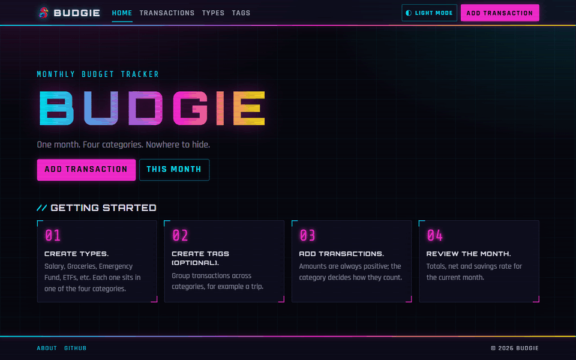
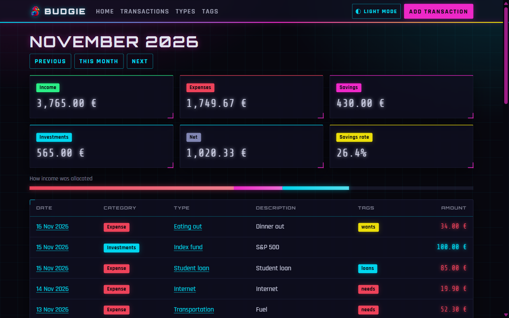
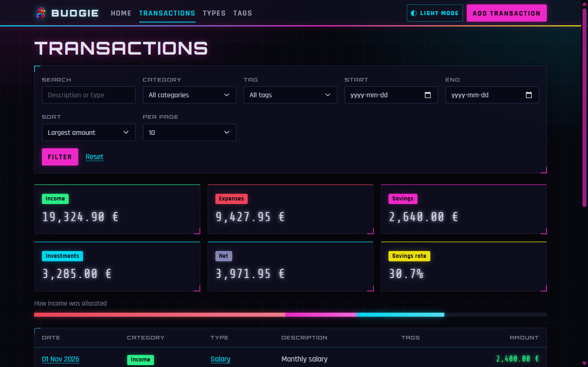
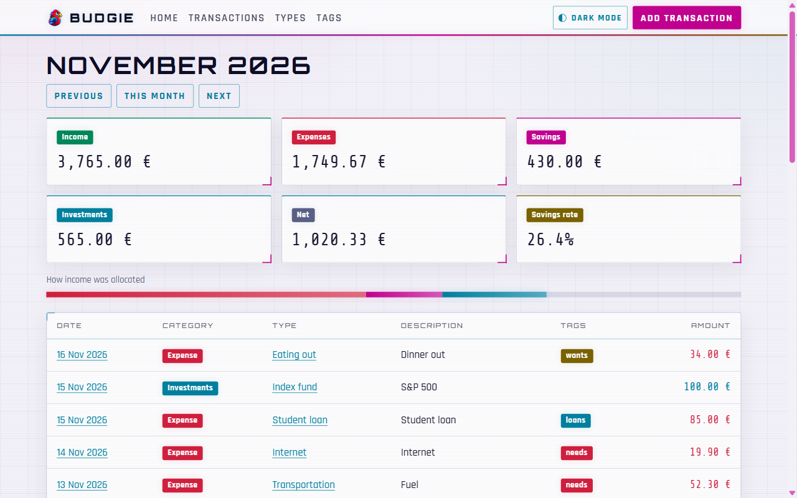

<h1> BUDGIE</h1>

<p>
  
  
  
  <a href="LICENSE"></a>
</p>

## Introduction

Budgie tracks a budget one month at a time. Every amount belongs to one of four categories — Income, Expenses, Savings or Investments — and the month page turns them into totals, a net figure and a savings rate.



## How It Works

Create **types** such as Salary, Groceries or ETF, each inside one of four fixed **categories**: Income, Expenses, Savings and Investments. Log **transactions** against them, optionally with **tags** like `summer-trip`. Each month page then shows the totals, the net amount and your savings rate.

- Monthly totals, net and savings rate, with previous and next month navigation
- Tags that group spending across categories and months
- Search, filters, sorting and pagination over all transactions
- Server-side validation with clear messages, and protected deletes
- Light and dark themes with no custom JavaScript

| Month page | All transactions | Light theme |
| --- | --- | --- |
|  |  |  |

## Quick Start

```bash
git clone https://github.com/rheinitz/budgie.git && cd budgie
python3 -m venv venv && source venv/bin/activate
pip install -r requirements.txt
python manage.py migrate
python manage.py runserver
```

Open <http://127.0.0.1:8000/>. The app needs no `.env` file and starts with an empty database. See the [installation guide](docs/getting-started/installation.md) for Windows, environment variables and the 404 page, and the [user guide](docs/getting-started/user-guide.md) for a first walk through.

## Documentation

| | |
| --- | --- |
| [Getting Started](docs/getting-started/installation.md) | Installation, configuration and the [User Guide](docs/getting-started/user-guide.md) |
| [Architecture](docs/architecture/overview.md) | Apps, the [Data Model](docs/architecture/data-model.md), and [URLs, Views and Templates](docs/architecture/urls-and-views.md) |
| [Development](docs/development/code-guide.md) | Code conventions and where to add a feature |
| [All docs](docs/README.md) | The full index and every screenshot |

## Contributing

Issues and pull requests are welcome. Read [CONTRIBUTING.md](CONTRIBUTING.md) for the branch and commit conventions and the checks to run first.

## License

[MIT](LICENSE) © 2026 rheinitz
