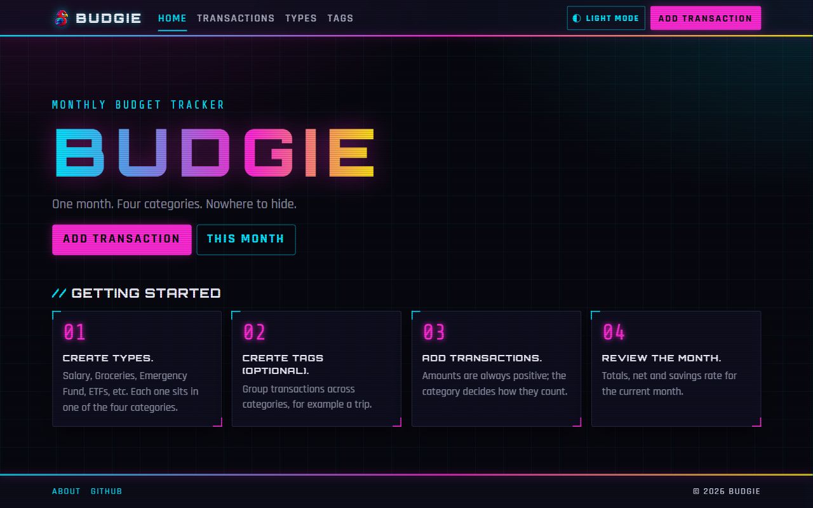
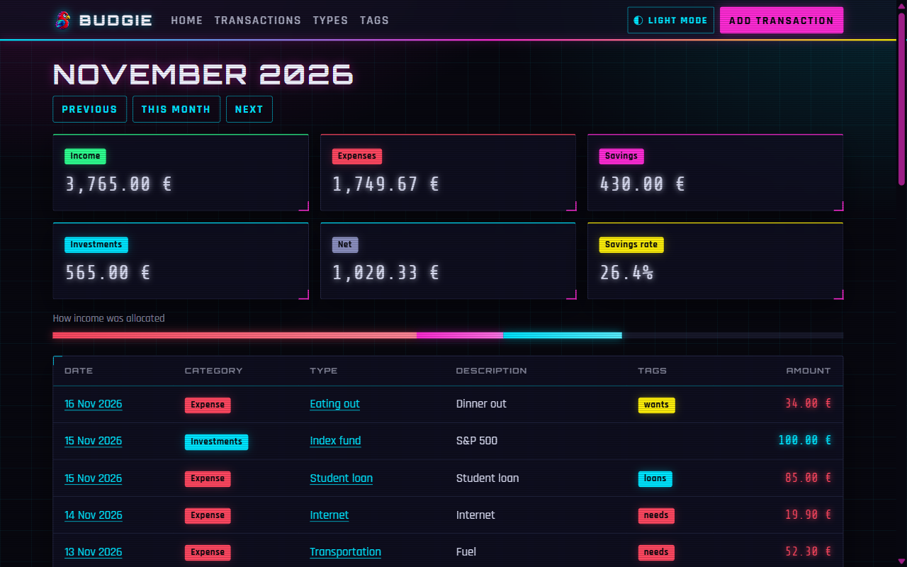
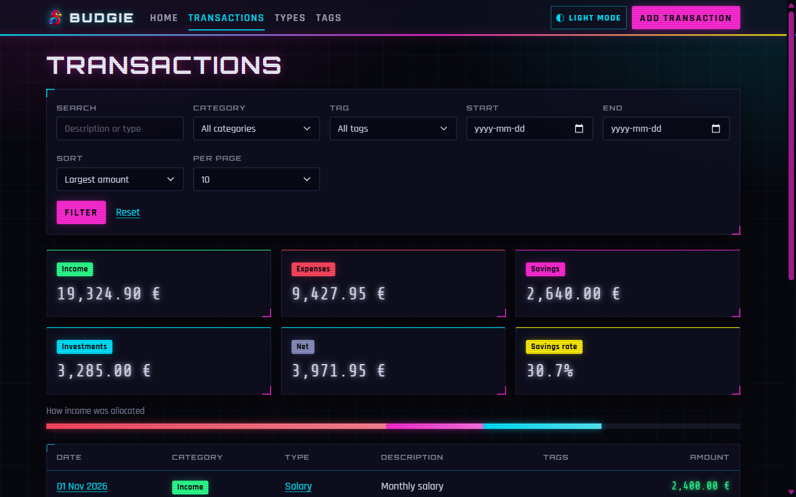
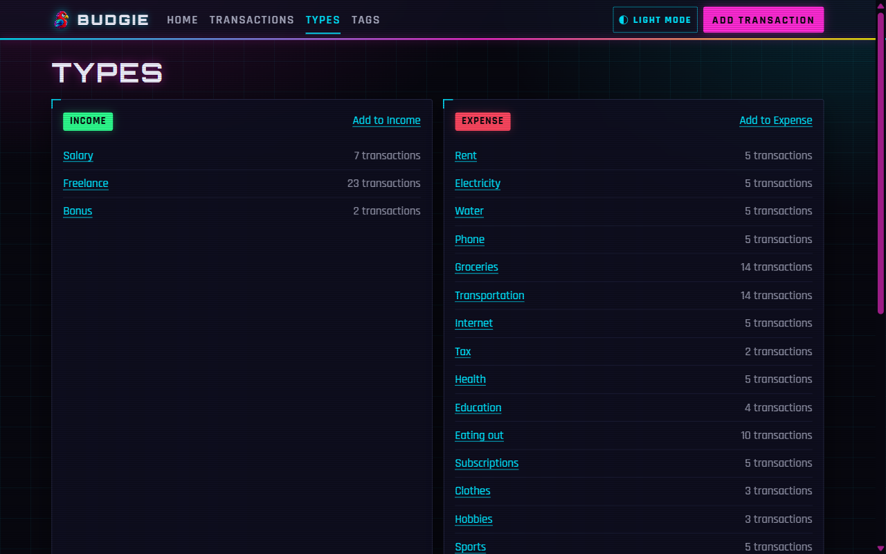
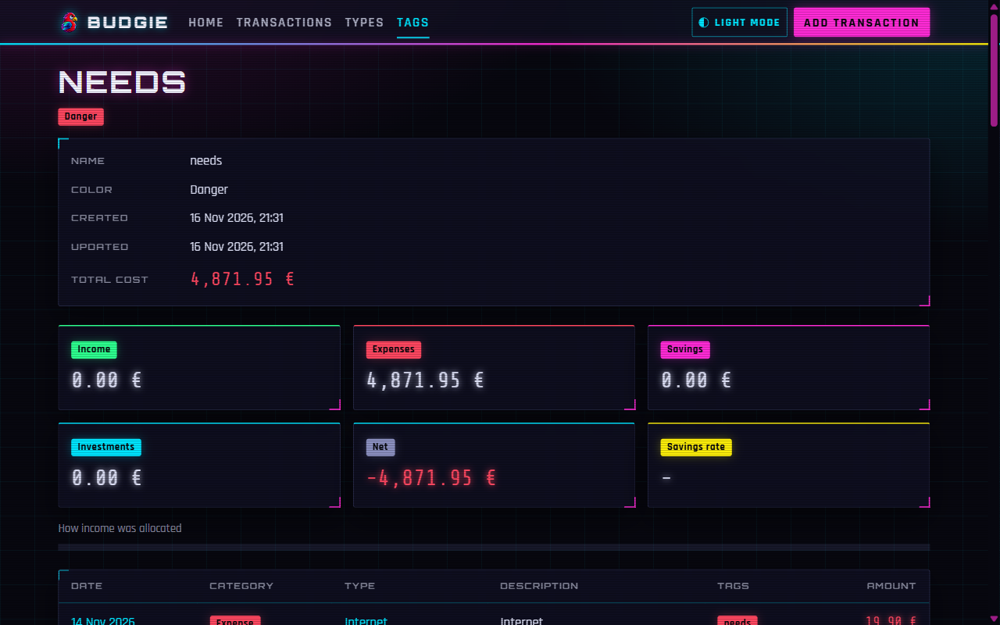
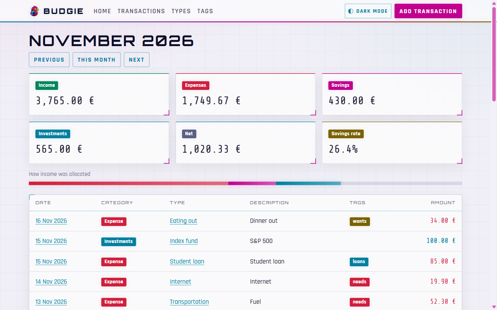
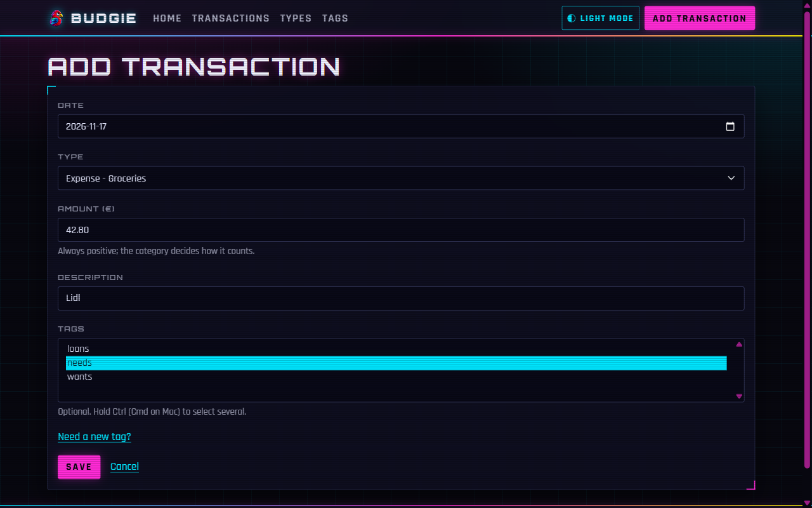
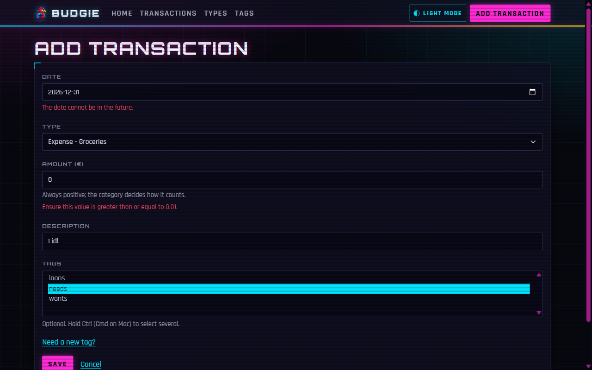
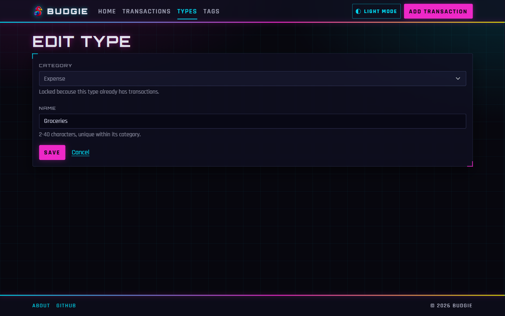

# Budgie documentation

Start with the [project README](../README.md) for a quick look. These pages go deeper.

## Getting started

| Page | What it covers |
| --- | --- |
| [Installation](getting-started/installation.md) | Setup on Linux, macOS and Windows, environment variables, the 404 page |
| [User guide](getting-started/user-guide.md) | A first walk through the app: types, tags, transactions, the month page |

## Architecture

| Page | What it covers |
| --- | --- |
| [Overview](architecture/overview.md) | Apps, dependencies, the request flow and the project layout |
| [Data model](architecture/data-model.md) | Models, relations, validation rules and how totals are calculated |
| [URLs, views and templates](architecture/urls-and-views.md) | Every route, the view behind it and the template it renders |

## Development

| Page | What it covers |
| --- | --- |
| [Code guide](development/code-guide.md) | Conventions, reusable mixins, the QuerySet, forms, template tags, theme and CSS |
| [Exam requirements](development/requirements.md) | Each SoftUni Django Basics requirement and where the project meets it |
| [Contributing](../CONTRIBUTING.md) | Branches, commits and the checks to run before a pull request |

## Screenshots

All images live in [`screenshots/`](screenshots/). They were taken with sample data entered for the demo; a fresh install starts empty.

| | |
| --- | --- |
|  |  |
| Home | Month page |
|  |  |
| All transactions | Types grouped by category |
|  |  |
| Tag detail | Light theme |
|  |  |
| Transaction form | Server-side validation |
|  | |
| Locked category on a type with transactions | |
