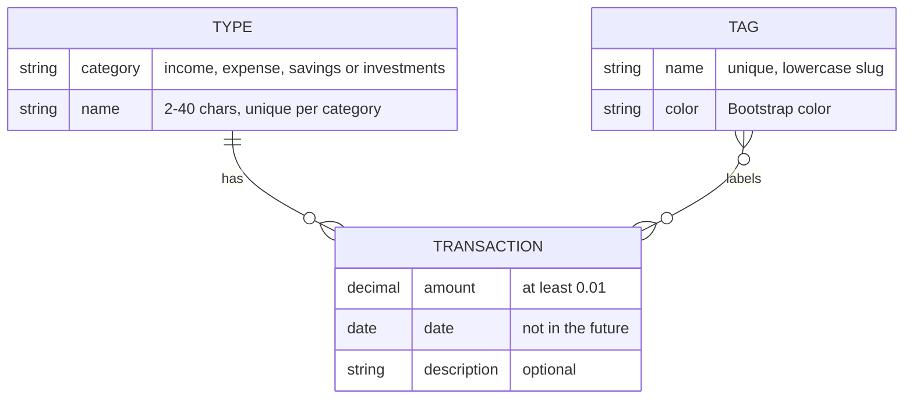

# Data Model

[Docs home](../README.md) · Previous: [Overview](overview.md) · Next: [URLs, Views and Templates](urls-and-views.md)

## Relations



- **Transaction to Type** is many-to-one with `on_delete=RESTRICT`: a type that still has transactions cannot be deleted.
- **Transaction to Tag** is many-to-many and optional. Deleting a tag removes only the links.
- All three models inherit `created_at` and `updated_at` from the abstract `TimeStampMixin` in `common/models.py`.

## Category

`categories/choices.py` defines the four fixed buckets as `TextChoices`: `income`, `expense`, `savings`, `investments`. They live in code, not in a table, because the totals depend on exactly these four. The `badge_color` property maps each one to a Bootstrap color (success, danger, primary, info).

## Type

`categories/models.py`

| Field | Rules |
| --- | --- |
| `category` | One of the four categories |
| `name` | 2-40 characters |

- `Meta.unique_together = [("category", "name")]` keeps names unique per category in the database.
- `clean()` also rejects the same name in a different letter case, such as `groceries` next to `Groceries`.
- `__str__` returns, for example, `Expense - Groceries`, which is what the transaction form's dropdown shows.
- `category_choice` returns the `Category` member, so templates can use its label and badge color.

## Tag

`tags/models.py`

| Field | Rules |
| --- | --- |
| `name` | Unique, 2-30 characters, pattern `^[a-z0-9]+(?:-[a-z0-9]+)*$` |
| `color` | One of the `TagColor` choices, default `secondary` |

`TagForm` normalizes the input before the model validates it: `Summer Trip` becomes `summer-trip`.

## Transaction

`transactions/models.py`

| Field | Rules |
| --- | --- |
| `type` | Required foreign key to `Type`, `RESTRICT` on delete |
| `tags` | Optional many-to-many to `Tag` |
| `amount` | `DecimalField(max_digits=10, decimal_places=2)`, at least `Decimal("0.01")` |
| `description` | Up to 200 characters, optional |
| `date` | Defaults to today, `validate_not_in_future`, indexed |

Ordered newest first (`-date`, `-created_at`). The `category` property returns the type's category. `get_month_url()` and `get_absolute_url()` give the redirect targets.

## TransactionQuerySet

`transactions/querysets.py`, attached with `objects = TransactionQuerySet.as_manager()`. Every filter method returns the QuerySet unchanged when its argument is empty, so they chain safely.

| Method | Purpose |
| --- | --- |
| `for_month(year, month)` | Transactions in one calendar month |
| `with_related()` | `select_related("type")` and `prefetch_related("tags")` to avoid N+1 queries |
| `search(text)` | Description or type name contains the text |
| `in_category(category)` | Filter on `type__category` |
| `with_tag(tag)` | Transactions carrying one tag |
| `between(start, end)` | Inclusive date range; either end may be empty |
| `totals_by_category()` | One `GROUP BY` query; returns all four categories, using 0.00 for missing ones |
| `totals()` | Wraps the sums in `CategoryTotals` |
| `total_amount()` | Plain sum, 0.00 when empty |

`totals_by_category()` calls `.order_by()` first. Without it, a sorted list would add the sort field to the `GROUP BY` and split the groups.

## How Totals Are Calculated

`CategoryTotals` in `transactions/totals.py` exposes the four sums plus:

```math
\text{net} = \text{income} - \text{expenses} - \text{savings} - \text{investments}
```

```math
\text{savings rate} = \frac{\text{savings} + \text{investments}}{\text{income}} \times 100
```

- The rate is rounded to one decimal place and is `None` (shown as a dash) when income is 0.
- Net can be negative, and the rate can exceed 100%. Both are shown as calculated.
- Money is always `Decimal`, created from strings such as `Decimal("0.01")`, never from floats.
- The currency symbol `€` comes from `CURRENCY_SYMBOL` in `common/constants.py`.

The same object feeds the month page, the filtered list and the tag pages. On a filtered list it totals only the matching rows.
