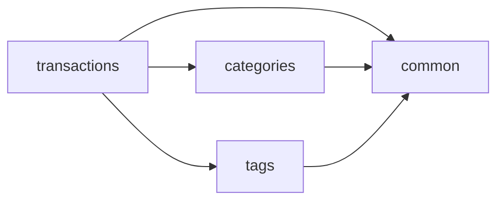
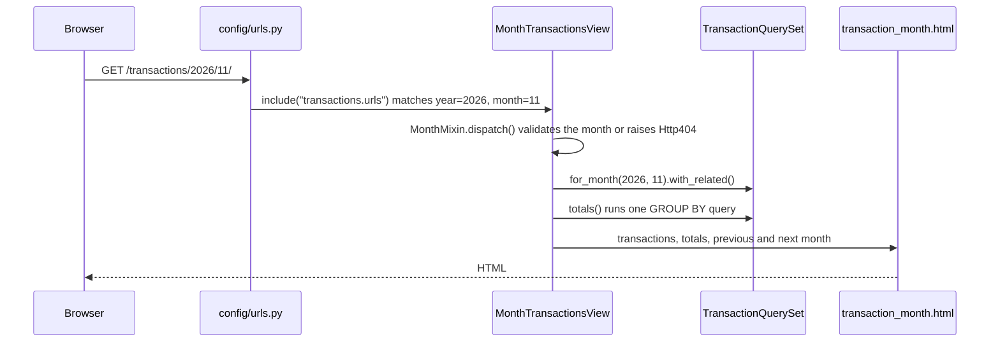

# Architecture overview

[Docs home](../README.md) · Next: [Data model](data-model.md)

Budgie is a server-rendered Django project. Every page is an HTML template, every change is a regular form POST, and the only JavaScript is the Bootstrap bundle that powers the mobile navbar.

## Stack

| Layer | Choice |
| --- | --- |
| Language | Python 3.12 |
| Framework | Django 6.1 (class-based views, ModelForms, the template engine) |
| Database | SQLite |
| Settings | `python-dotenv` reads an optional `.env` file |
| UI | Bootstrap 5.3 from the jsDelivr CDN, four project stylesheets, Google Fonts |

## Apps

Each app has one responsibility.

| App | Responsibility |
| --- | --- |
| `common` | Home and about pages, the theme switch, shared form and view mixins, month helpers, the `money` filter and `totals_cards` tag, the abstract `TimeStampMixin`. No concrete models. |
| `categories` | The fixed `Category` choices and the `Type` model with full CRUD under `/types/`. |
| `tags` | The `Tag` model with full CRUD under `/tags/`. |
| `transactions` | The `Transaction` model, its chainable QuerySet, the totals object, full CRUD, the month page and the filtered list. |

## Dependencies



- `common` never imports a feature app.
- `categories` and `tags` never import `transactions`. They reach transactions through the reverse relation `related_name="transactions"`, for example `tag.transactions.totals()`.
- Reverse managers are built from `Transaction`'s default manager, so every `TransactionQuerySet` method works on them without an import.

## Request flow

Example: `GET /transactions/2026/11/`.



1. `config/urls.py` matches `transactions/` and hands the rest to `transactions/urls.py`.
2. That URLconf matches `<int:year>/<int:month>/` and calls `MonthTransactionsView`.
3. `MonthMixin.dispatch()` turns the year and month into a date, or raises `Http404` for something like month 13.
4. `get_queryset()` builds a lazy QuerySet. No SQL runs yet.
5. `get_context_data()` adds the totals and the previous and next months.
6. Rendering the table runs one JOIN for the types and one query for the tags. The page needs about three queries no matter how many transactions the month has.

## Project layout

```text
Budgie/
├── config/          settings.py, urls.py, wsgi.py, asgi.py
├── common/          views, urls, mixins, forms, utils, constants, context_processors, templatetags/
├── categories/      choices, models, forms, views, urls, admin
├── tags/            choices, models, forms, views, urls, admin
├── transactions/    models, querysets, totals, validators, choices, mixins, forms, views, urls, admin
├── templates/       base.html, 404.html, partials/, common/, categories/, tags/, transactions/
├── static/          css/ (theme, layout, components, pages), images/favicon.png
├── docs/            this documentation and the screenshots
├── .env.example     every environment variable, with notes
├── requirements.txt
└── manage.py
```

Continue with the [data model](data-model.md).
