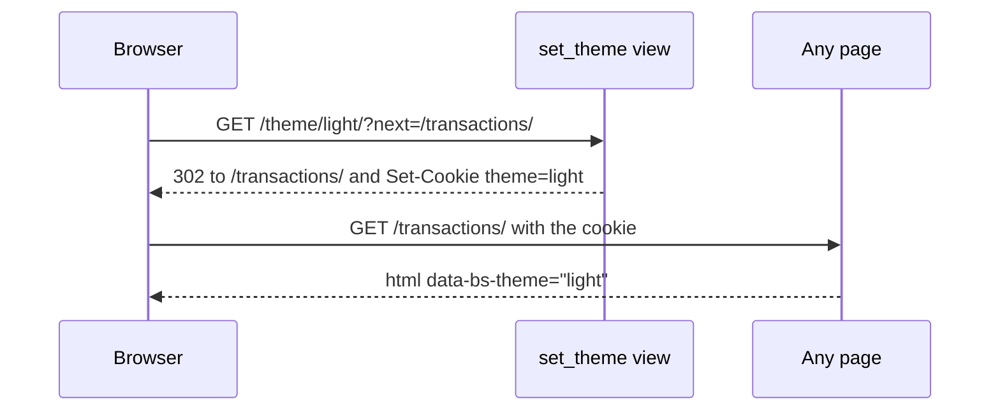

# Code guide

[Docs home](../README.md) · Previous: [URLs, views and templates](../architecture/urls-and-views.md) · Next: [Exam requirements](requirements.md)

How the code is organized and the conventions new code should follow. For the workflow (branches, commits, pull requests), see [CONTRIBUTING](../../CONTRIBUTING.md).

## Conventions

- **PEP 8**, with imports grouped as standard library, third-party, then local.
- **Type hints** on every function and method.
- **Class-based views** by default. Function views only where there is no fitting generic view: `current_month` and `set_theme`.
- **Rules live in models** (validators, `clean()`, `Meta`), **query logic in `TransactionQuerySet`**, **presentation in templates**.
- **Explicit `fields`** in every `ModelForm`, never `"__all__"`. Timestamps are never form fields.
- **Money is `Decimal`**, created from strings: `Decimal("0.01")`, never `Decimal(0.01)`.
- **No hard-coded internal URLs.** Use ``, `reverse`, `reverse_lazy` or `get_absolute_url()`.
- **Catch specific exceptions only**: `ValueError` in the month helper, `RestrictedError` on delete, `InvalidOperation` and `TypeError` in the `money` filter.
- **Avoid shadowing built-ins.** A loop over types uses `budget_type`, not `type`.
- **Comments are short** and only explain what the code cannot show.

## Reusable pieces

| Piece | File | What it does |
| --- | --- | --- |
| `TimeStampMixin` | `common/models.py` | Abstract model adding `created_at` and `updated_at` |
| `BootstrapFormMixin` | `common/forms.py` | Adds `form-control` or `form-select` to every widget |
| `DisabledFieldsMixin` | `common/forms.py` | Disables every field; turns a model form into a read-only delete form |
| `DeleteFormInstanceMixin` | `common/mixins.py` | Passes `instance=self.object` to a `DeleteView` form |
| `MonthMixin` | `common/mixins.py` | Validates `year` / `month` in `dispatch()` and adds previous and next months to the context |
| `TransactionMonthRedirectMixin` | `transactions/mixins.py` | Sends the user to the transaction's month after create, edit or delete |
| `get_month_start_or_404`, `shift_month` | `common/utils.py` | Month arithmetic without extra packages |
| `money` filter | `common/templatetags/budgie_tags.py` | Formats a number as `1,234.56 €`; returns an empty string for bad input |
| `totals_cards` inclusion tag | `common/templatetags/budgie_tags.py` | Renders the six totals cards and the allocation bar from a `CategoryTotals` |
| `theme` context processor | `common/context_processors.py` | Exposes `theme` and `other_theme` to every template |

A delete form is one line because the mixins do the work:

```python
class TypeDeleteForm(DisabledFieldsMixin, TypeForm):
    pass
```

## Forms

| Form | Notable behavior |
| --- | --- |
| `TypeForm` | Locks `category` once the type has transactions; a disabled field ignores tampered POST data |
| `TagForm` | `clean_name()` lowercases the name and joins words with hyphens before the model's pattern check |
| `TransactionForm` | `step="0.01"` but no HTML `min` or `max`, so the server's error messages are the ones the user sees |
| `TransactionFilterForm` | A plain `forms.Form` used with GET; `clean()` rejects a start date after the end date |

Every form sets labels, placeholders where useful, help texts and custom error messages in `Meta`. The shared `partials/form_fields.html` renders fields, help text and errors the same way everywhere.

## Theme switch without JavaScript



Bootstrap 5.3 reads `data-bs-theme` on `<html>`. The context processor falls back to dark for a missing or tampered cookie.

## Styles

`templates/base.html` loads four stylesheets after Bootstrap, in this order. There is no build step.

| File | Contents |
| --- | --- |
| `static/css/theme.css` | Fonts and the color variables for both themes. Must load first. |
| `static/css/layout.css` | Background, typography, navbar and footer |
| `static/css/components.css` | Cards, stat cards, lists, buttons, forms, tables, badges, progress bars |
| `static/css/pages.css` | Detail lists, the home hero and steps, reduced-motion overrides. Must load last. |

Section comments in the CSS use one block style:

```css
/* 
------------------------------------------------------------------------
   Section name
------------------------------------------------------------------------
*/
```

## Adding a feature

1. Put the model rules in the model, and query logic in `TransactionQuerySet` if it touches transactions.
2. Run `python manage.py makemigrations` and commit the migration with the model change.
3. Write the view as a generic CBV, reusing the mixins above.
4. Add a named route in the app's `urls.py`, and link to it from an existing page so nothing is orphaned.
5. Extend `base.html` and reuse the partials.
6. Run the checks in [CONTRIBUTING](../../CONTRIBUTING.md#before-you-open-a-pull-request).
