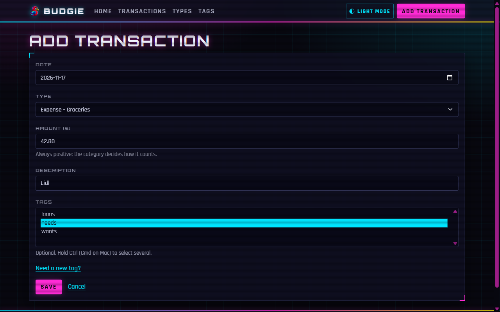
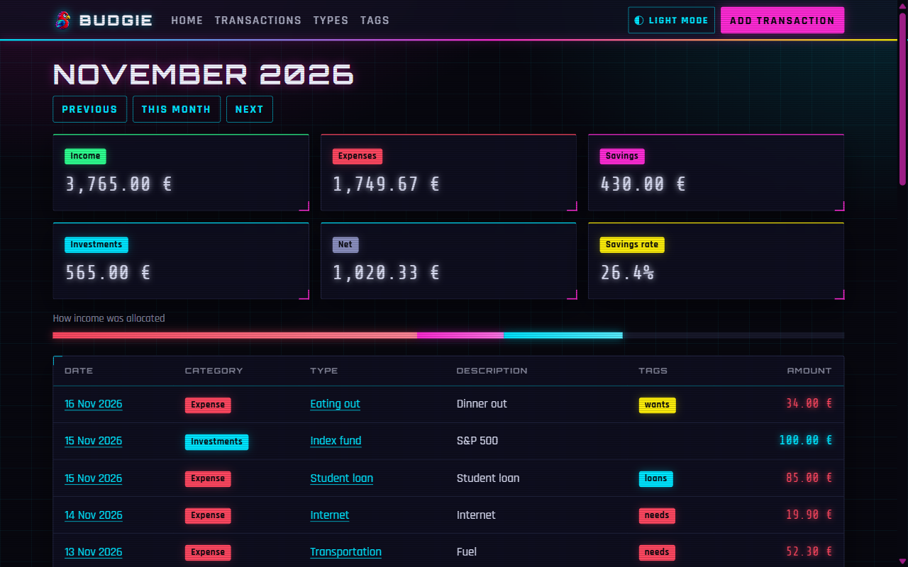
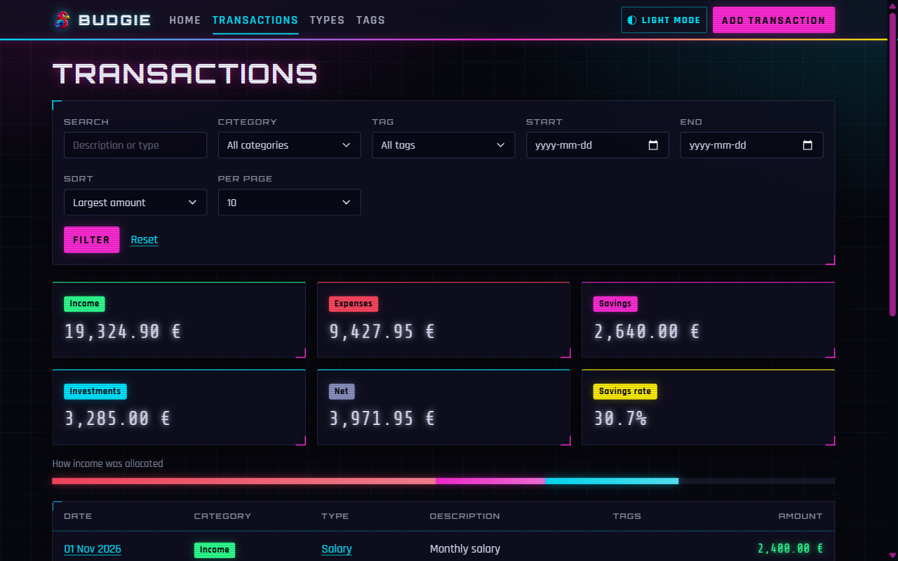
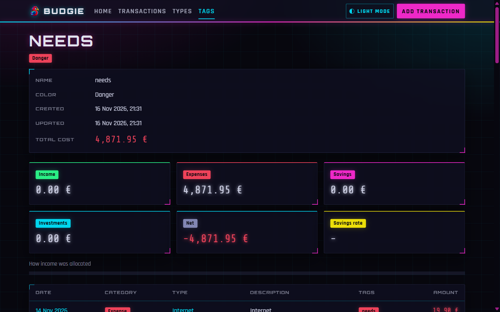
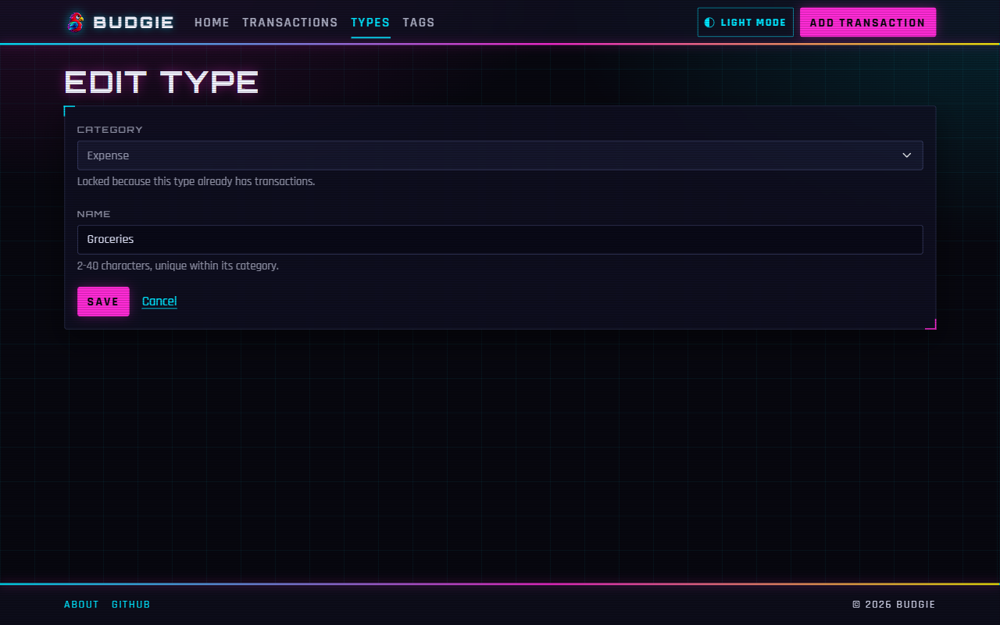
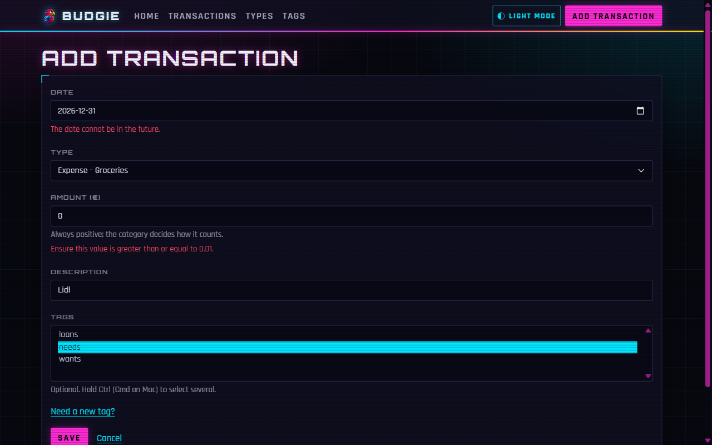
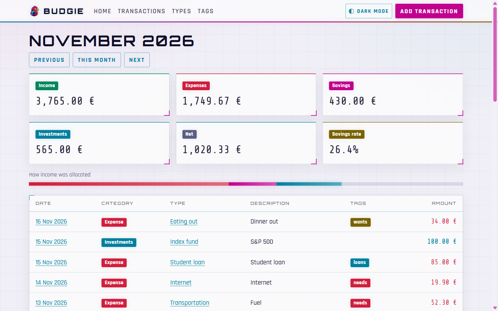

# User Guide

[Docs home](../README.md) · Previous: [Installation](installation.md) · Next: [Architecture Overview](../architecture/overview.md)

Budgie tracks one month at a time. Every amount you enter lands in one of four fixed **categories**, and the month page turns them into totals, a net figure and a savings rate.

## Three Ideas

| Idea | What it is | Examples |
| --- | --- | --- |
| **Category** | One of four fixed buckets. Decides how an amount counts in the totals. | Income, Expense, Savings, Investments |
| **Type** | A name you create inside one category. Every transaction has exactly one. | Salary, Groceries, Emergency fund, ETF |
| **Tag** | An optional label that groups transactions across categories and months. | `needs`, `wants`, `summer-trip` |

Amounts are always positive. A 50 € grocery bill and a 50 € salary are both entered as `50.00`; the type's category decides whether the money came in or went out.

## First Steps

Every step below starts from a link in the navbar or on the home page.

1. **Create a type.** Open **Types** and use "Add to Income" (or any other category), for example `Salary`. Then add an expense type such as `Groceries`.
2. **Create a tag (optional).** Open **Tags**, then add one. Type `Summer Trip` and it is saved as `summer-trip`.
3. **Add a transaction.** Click **Add transaction**, pick a type, enter an amount and a date, and optionally select tags with Ctrl+click (Cmd+click on Mac). After saving you land on that transaction's month.
4. **Review the month.** Use **This month** on the home page, then Previous / Next to move between months.

## The Month Page

| Card | Meaning |
| --- | --- |
| Income, Expenses, Savings, Investments | Sum of the month's transactions in each category |
| Net | Income minus Expenses, Savings and Investments. Shown in red when negative. |
| Savings rate | (Savings + Investments) / Income, as a percentage. A dash when there is no Income. |

The bar below the cards shows how Income was split between Expenses, Savings and Investments.

## All Transactions

**Transactions** in the navbar lists every transaction with filters for text (description or type name), category, tag and a date range, plus sorting and 10, 20, 50 or 100 rows per page. Pagination keeps the filters in the URL, so a filtered page can be bookmarked.

The cards above the list total **only the rows that match the filter**. With only Expenses selected, Income is 0, so Net is negative and the Savings rate is a dash. That is expected.

## Tags

A tag's page lists every transaction carrying it, across all months, with the same cards. Its **total cost** is the sum of the tagged expenses, which answers questions like "what did the trip cost?".

## Editing and Deleting

Every type, tag and transaction has Edit and Delete links on its detail page. Each delete goes through a confirmation page that shows the record in read-only fields.

- **Types with transactions are protected.** Their category is locked on the edit form, and the delete page explains why it cannot be deleted. Move or delete the transactions first.
- **Deleting a tag** only removes the label. Its transactions stay.
- **Deleting a transaction** returns you to its month.

## Validation

Mistakes are caught on the server and shown next to the field:

- the amount must be at least 0.01 and have at most two decimals;
- the date cannot be in the future;
- a type name must be 2-40 characters and unique within its category, ignoring letter case;
- a tag name may only use letters, digits and single hyphens;
- in the filters, the start date must be on or before the end date.

## Light and Dark Theme

The button in the navbar switches themes and keeps you on the same page. The choice is stored in a cookie for a year. Dark is the default.

